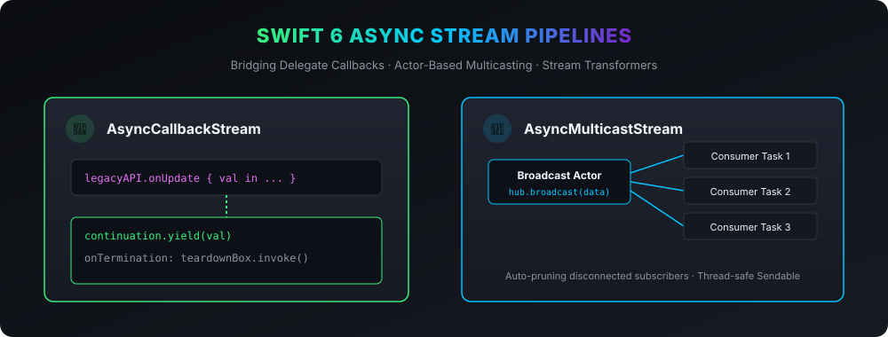

# Swift AsyncStreamKit 🌊

Idiomatic Swift 6 `AsyncStream` & `AsyncThrowingStream` adapters: legacy callback/delegate bridges, multicast broadcast streams, and stream transformers.

[](https://github.com/nilkanthdesai76/swift-async-stream-kit/actions)
[](https://swift.org)
[](https://developer.apple.com)
[](https://swift.org/package-manager/)
[](LICENSE)

<p align="center">
  
</p>

---

## 🎯 Motivation

Swift Concurrency's `AsyncStream` is a powerful primitive, but standard Apple platforms still have key friction points:
1. **Bridging legacy delegate & closure callbacks** requires manual boilerplate, continuation retention, and fragile cancellation teardowns.
2. **`AsyncStream` is single-consumer** by design — iterating a stream in more than one `Task` causes race conditions or drops events.
3. **No built-in rate-limiting**: Throttling and debouncing high-frequency event streams (like location or socket messages) requires custom logic.

**AsyncStreamKit** solves these issues with zero dependencies and strict Swift 6 concurrency safety.

---

## 📦 Features

- 🔄 **`AsyncCallbackStream`**: Bridges any closure, delegate, or notification observer into an `AsyncStream` with guaranteed `onTermination` cleanup.
- 📡 **`AsyncMulticastStream`**: Actor-based pub/sub broadcast hub enabling any number of concurrent subscriber tasks from a single stream.
- ⏱️ **`.debounced()` & `.throttled()`**: Rate-limiting operators directly on `AsyncStream`.
- 🛡️ **Swift 6 Strict Concurrency**: All types are `Sendable`, zero data races.

---

## 🚀 Usage

### 1. Bridging Legacy Callbacks to `AsyncStream`

```swift
import AsyncStreamKit

// Transform a legacy callback API into an AsyncStream
let stream = AsyncCallbackStream.makeStream(of: Location.self) { continuation in
    let token = locationManager.onLocationChanged { location in
        continuation.yield(location)
    }
    
    // Automatically called when consumer task cancels or finishes
    return {
        locationManager.unregister(token)
    }
}

for await location in stream {
    print("New coordinate: \(location)")
}
```

### 2. Multicast Fan-out to Multiple Tasks

```swift
let hub = AsyncMulticastStream<SensorReading>()

// Task 1: UI Display
Task {
    for await reading in await hub.subscribe() {
        updateGauges(reading)
    }
}

// Task 2: Background Logger
Task {
    for await reading in await hub.subscribe() {
        logToDatabase(reading)
    }
}

// Broadcast to all active subscribers simultaneously
await hub.broadcast(SensorReading(temp: 72.4))
```

### 3. Throttling and Debouncing Streams

```swift
// Debounce search keystrokes by 300ms
for await query in searchStream.debounced(by: 0.3) {
    await performSearch(query)
}

// Throttle sensor telemetry to at most 1 update per second
for await sample in rawSensorStream.throttled(by: 1.0) {
    await sendToServer(sample)
}
```

---

## 🛠️ Installation via Swift Package Manager

Add the following to your `Package.swift`:

```swift
dependencies: [
    .package(url: "https://github.com/nilkanthdesai76/swift-async-stream-kit.git", from: "1.0.0")
]
```

---

## 📄 License

This project is licensed under the MIT License - see the [LICENSE](LICENSE) file for details.
